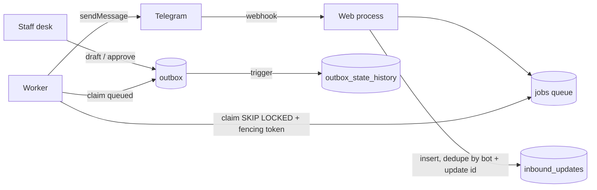

# Telegram Program Bots: reliable messaging core (excerpt)

> **Status: Work in progress.** This repository is a **curated excerpt and architecture overview**, not the full application. It is not runnable as a bot on its own.

Unity Art Collective runs its learning, studio, events and creator programmes through several Telegram bot identities. Levi Howze (Army Captain turned finance and risk leader) built the platform behind them with AI coding tools: one Node.js codebase, one PostgreSQL database, one web process and one worker, where each bot is a configuration row rather than a separate app.

This excerpt publishes the part that best shows the engineering approach: **a message pipeline designed so that nothing is sent twice, nothing is sent without approval, and every state change is auditable.**

## Why it matters (risk and controls angle)

- **Human approval before sending.** Outbound messages move through `draft → approved → queued → sending → sent | failed | unknown | cancelled`. Once approved, the message snapshot is immutable (enforced by a database trigger).
- **No silent double-sends.** If a send's outcome is ambiguous (network failure, server error), the message goes to `unknown` and is never retried automatically; a person decides.
- **Safe concurrency.** Postgres is the queue: jobs are claimed with `FOR UPDATE SKIP LOCKED`, leases expire, and a fencing token stops a stale worker from completing work it no longer owns.
- **Audit trail.** Every outbox state transition is written to a history table by trigger.
- **Rate-limit aware.** Telegram 429 responses honour `retry_after`; 403 is a definitive stop.
- **Kill switches.** Sending requires an environment flag and a per-bot flag; a dry-run mode and a private-test mode restrict what can go out.
- **Log hygiene.** Logs redact secret-named fields and token-shaped strings.

## Architecture



## What's here

| Path | What |
|---|---|
| `migrations/0003_jobs_outbox.sql` | Jobs queue, outbox, state history, pacing tables and the integrity triggers (references tables defined in other migrations that are not included) |
| `src/platform/jobs.ts` | Job claim, complete and lease recovery with fencing tokens |
| `src/platform/outbox.ts` | Outbox state machine, send claim and outcome handling |
| `src/platform/telegram.ts` | Telegram send wrapper and response classification |
| `src/platform/redact.ts` | Structured logging with secret redaction |
| `test/` | Unit tests for response classification and redaction |

```bash
npm install
npm run typecheck
npm test
```

## Tech stack (full platform)

TypeScript · Node.js 22 · PostgreSQL (PGlite for local tests) · TanStack Start · Telegram Bot API

## Intentionally omitted (security and privacy)

- Authentication, sessions, staff roles and access control, webhook verification, encryption and admin code.
- Bot tokens, database URLs, hosting and deployment configuration, operational scripts and git history.
- Bot reply texts, programme content, and all user, student or tester data.
- The separate sales-desk bot (payments) is not included at all.

## Rights

No open-source license is granted for this repository unless one is added later.
